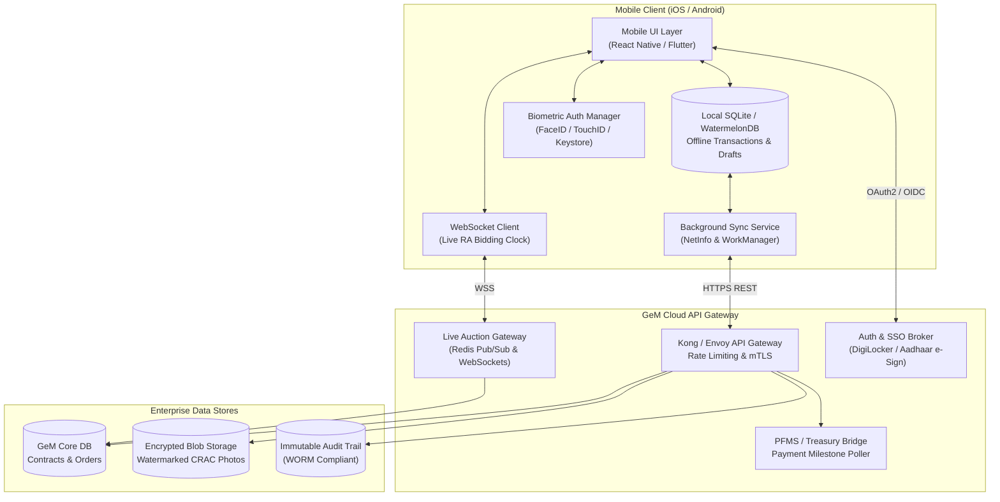

# GeM Mobile Companion: Technical Architecture & UI Screen Specifications

> **Companion Document to:** [GeM Mobile Companion PRD](file:///Users/giradasaiteja/.gemini/antigravity/brain/e6973303-6cdb-4b69-9bb6-ee44d3d58fed/gem_mobile_companion_prd.md)  
> **Target Framework:** React Native / Expo (TypeScript) or Flutter  
> **Architecture Pattern:** Offline-First Sync with Local SQLite & WebSocket Bid Room  

---

## 1. System Architecture Overview



---

## 2. Information Architecture (IA) & Navigation Tree

```text
GeM Mobile Companion
├── [Tab 1] Home / Executive Dashboard
│   ├── Pending Action Banners (Urgent POs, Expiring Auctions)
│   ├── Quick Stat Cards (Pending CRAC, Overdue PFMS Invoices)
│   └── Role Switcher (Buyer / Consignee / Seller)
├── [Tab 2] Auctions & Bids (RA Room)
│   ├── Live Auctions (Active Countdown Timer, L1 Indicator)
│   ├── Upcoming Bids & Participating Categories
│   └── Quick Bidding Modal (Biometric Authorization)
├── [Tab 3] Orders & Field CRAC
│   ├── Pending Inspection Orders
│   ├── Continuous Barcode / QR Scanner
│   ├── Camera Module (GPS + UTC Watermark Stamp)
│   ├── Defect Reporting & Checklist
│   └── Offline Inspection Queue
├── [Tab 4] Invoices & PFMS Tracker
│   ├── 5-Stage Milestone Progression View
│   ├── Statutory 10-Day SLA Countdown & Warning Alarms
│   └── Bank UTR & Treasury Clearance Proofs
└── [Tab 5] Verified Chat & Support
    ├── Order-Bound Direct Channels
    └── Catalog Rejection AI Diagnostics
```

---

## 3. High-Fidelity UI Wireframes

### Screen 1: Live Reverse Auction (RA) Bidding Screen
*Optimized for MSME vendors (Rajesh Sharma) under poor connectivity to eliminate bidding timeouts.*

```text
┌────────────────────────────────────────────────────────┐
│ 09:41                   GeM Companion         [📶 4G]   │
├────────────────────────────────────────────────────────┤
│ ◀ RA-2026-889104                 [ 🔴 LIVE AUCTION ]    │
│ Supply of 5000x Heavy-Duty LED Luminaires (70W)        │
│ Buyer: Military Engineer Services (MES) - Western Cmd  │
├────────────────────────────────────────────────────────┤
│ ⏱ AUCTION CLOSES IN:                                  │
│   ┌────────────────────────────────────────────────┐   │
│   │             04m : 18s . 400ms                  │   │
│   │  (Auto-extends +5 min if bid placed < 2 min)   │   │
│   └────────────────────────────────────────────────┘   │
├────────────────────────────────────────────────────────┤
│ CURRENT STANDING                                       │
│   Rank: #2 (L2)         Your Best Bid: ₹ 4,250 / unit  │
│   Lowest Bid (L1):      ₹ 4,180 / unit (Diff: -₹ 70)   │
│   Total Contract Value: ₹ 2,09,00,000                   │
├────────────────────────────────────────────────────────┤
│ QUICK COUNTER-BID INCREMENTS                           │
│   ┌──────────────┐ ┌──────────────┐ ┌──────────────┐   │
│   │   - ₹ 20     │ │   - ₹ 50     │ │   - ₹ 100    │   │
│   │ (₹ 4,160)    │ │ (₹ 4,130)    │ │ (₹ 4,080)    │   │
│   └──────────────┘ └──────────────┘ └──────────────┘   │
│                                                        │
│ Custom Price / Unit: [ ₹ 4,150.00                   ]  │
│ Total Impact: ₹ 2,07,50,000 (New L1 Position)          │
├────────────────────────────────────────────────────────┤
│ [ ⚡ SLIDE TO SUBMIT BID (₹ 4,150) ═══════════════▶ ] │
│ 🔒 Confirmed via Fingerprint / Face ID (No SMS OTP)    │
└────────────────────────────────────────────────────────┘
```

---

### Screen 2: Field-Level Consignee Inspection (CRAC)
*Designed for outdoor logistics depots (Vikramaditya Patel) with offline camera and barcode scanner.*

```text
┌────────────────────────────────────────────────────────┐
│ 11:15                CRAC Field Inspector     [📴 OFFLINE]│
├────────────────────────────────────────────────────────┤
│ PO # MES-2026-7712              Consignee: Northern Rly│
│ Consignment: 240x Railway Brake Assembly Units          │
│ Vendor: Kanpur Precision Fasteners (MSME)               │
├────────────────────────────────────────────────────────┤
│ 1. BARCODE / QR VERIFICATION                           │
│   [ 📷 SCAN PALLET QR ]   ✅ Scanned: PAL-88190-MES    │
│   Verified: 240 / 240 units matched with delivery note │
├────────────────────────────────────────────────────────┤
│ 2. TAMPER-PROOF PHOTO EVIDENCE (Min 2 required)        │
│   ┌──────────────┐ ┌──────────────┐ ┌──────────────┐   │
│   │ [IMG 1]      │ │ [IMG 2]      │ │   + ADD      │   │
│   │ Geo: 26.44 N │ │ Seal Intact  │ │   PHOTO      │   │
│   │ 24-Oct 11:12 │ │ 24-Oct 11:14 │ │              │   │
│   └──────────────┘ └──────────────┘ └──────────────┘   │
│   ℹ GPS: 26.4499° N, 80.3319° E | Altitude: 126m       │
├────────────────────────────────────────────────────────┤
│ 3. DEFECT INSPECTION CHECKLIST                         │
│   [x] Outer Packaging Undamaged                        │
│   [x] Manufacturer Test Cert Attached (BIS / ISO)       │
│   [ ] Quantity Match: [ 240 ] Accepted / [ 0 ] Rejected│
├────────────────────────────────────────────────────────┤
│ 4. CRAC SIGN-OFF STATUS                                │
│   [✓] Issue Full Acceptance Certificate (CRAC)         │
│   [ ] Issue Provisional Receipt (PRC only)             │
│   [ ] Issue Rejection & Return Notice                  │
├────────────────────────────────────────────────────────┤
│  ┌──────────────────────────────────────────────────┐  │
│  │   [ 💾 SIGN & SAVE TO LOCAL QUEUE (OFFLINE) ]    │  │
│  │   Auto-syncs as soon as 4G/WiFi is detected      │  │
│  └──────────────────────────────────────────────────┘  │
└────────────────────────────────────────────────────────┘
```

---

### Screen 3: PFMS Payment Milestone & Auto-Escalation Tracker
*Provides complete transparency to sellers (Rajesh Sharma & Priya Sundaram) on disbursement status.*

```text
┌────────────────────────────────────────────────────────┐
│ 14:20                Payment Tracker          [📶 5G]   │
├────────────────────────────────────────────────────────┤
│ Contract: GEMC-51168772091             Total: ₹ 14.8 L │
│ Milestone: 100% Final Payment post-CRAC                │
│ Buyer: Dept of Health & Family Welfare (GMCH Hospital) │
├────────────────────────────────────────────────────────┤
│ STATUTORY 10-DAY CRAC TIMER:                           │
│ ┌────────────────────────────────────────────────────┐ │
│ │  🟢 CRAC ISSUED (Day 3 of 10)                      │ │
│ │  Statutory Compliance: Approved within deadline    │ │
│ └────────────────────────────────────────────────────┘ │
├────────────────────────────────────────────────────────┤
│ MILESTONE PROGRESSION                                  │
│                                                        │
│  ● 1. Order Accepted by Seller           14-Oct-2026   │
│  │                                                     │
│  ● 2. Material Dispatched & In Transit    17-Oct-2026   │
│  │                                                     │
│  ● 3. Goods Delivered to Hospital Depot   19-Oct-2026   │
│  │                                                     │
│  ● 4. CRAC Certificate Signed Off        22-Oct-2026   │
│  │                                                     │
│  ◐ 5. PFMS Treasury Sanction (PROCESSING)              │
│  │  ├─ PFMS Bill ID: 2026-PFMS-9981240                 │
│  │  ├─ Treasury Token: State Bank of India             │
│  │  └─ Expected Bank Credit: 26-Oct-2026 (48 hrs)      │
│  │                                                     │
│  ○ 6. Bank UTR Generated & Transferred                 │
├────────────────────────────────────────────────────────┤
│ NEED CLARIFICATION?                                    │
│ [ 💬 Chat with Hospital Accounts Officer ]             │
│ [ ⚠ Raise GeM SLA Escalation Ticket ]                  │
└────────────────────────────────────────────────────────┘
```

---

## 4. REST & WebSocket API Contracts

### Endpoint 1: Submit Live Reverse Auction Bid
`POST /api/v1/auctions/{auctionId}/bid`

```json
{
  "bid_id": "bid_98a72b10",
  "seller_id": "usr_rajesh_msme",
  "unit_price": 4150.00,
  "currency": "INR",
  "biometric_auth_token": "bio_sig_f893e1a044bc...",
  "device_timestamp": "2026-10-24T11:42:15.102Z",
  "clock_drift_offset_ms": 14
}
```

**Response (200 OK):**
```json
{
  "status": "ACCEPTED",
  "rank": 1,
  "is_l1": true,
  "next_minimum_bid": 4130.00,
  "auction_extended": false,
  "remaining_time_ms": 258400
}
```

---

### Endpoint 2: Submit Offline Field CRAC Inspection
`POST /api/v1/inspections/sync`

```json
{
  "inspection_id": "insp_rail_88921a",
  "po_number": "PO-MES-2026-7712",
  "consignee_id": "usr_patel_depot",
  "inspection_status": "ACCEPTED",
  "accepted_quantity": 240,
  "rejected_quantity": 0,
  "offline_created_at": "2026-10-24T11:12:30Z",
  "geo_location": {
    "latitude": 26.449912,
    "longitude": 80.331904,
    "accuracy_meters": 3.8
  },
  "scanned_barcodes": ["PAL-88190-MES"],
  "evidence_photos": [
    {
      "photo_hash": "sha256_e3b0c44298fc1c149afbf4c8996fb92427ae41e4649b934ca495991b7852b855",
      "storage_url": "s3://gem-evidence/2026/10/photo_01.webp"
    }
  ]
}
```

---

## 5. Implementation Stack Recommendation

* **Mobile Core:** React Native (Expo SDK 52) with TypeScript for fast cross-platform deployment.
* **Local Offline Storage:** SQLite via `WatermelonDB` or `@op-engineering/op-sqlite` for sub-millisecond local reads/writes.
* **Camera & Scanner:** `expo-camera` with OpenCV native bridge for watermarking coordinates directly onto the pixel buffer.
* **Real-time Sync:** `Phoenix Channels` or `Socket.io` with automatic reconnection and client clock compensation.
* **Biometrics:** `expo-local-authentication` linked to Android Keystore / iOS Keychain for non-repudiation.
