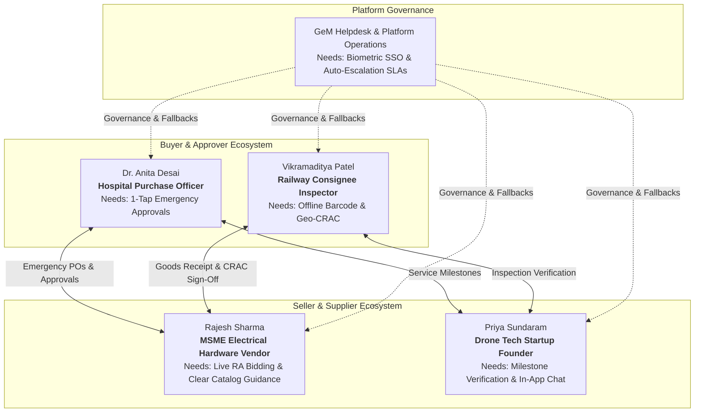
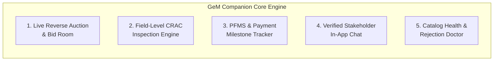
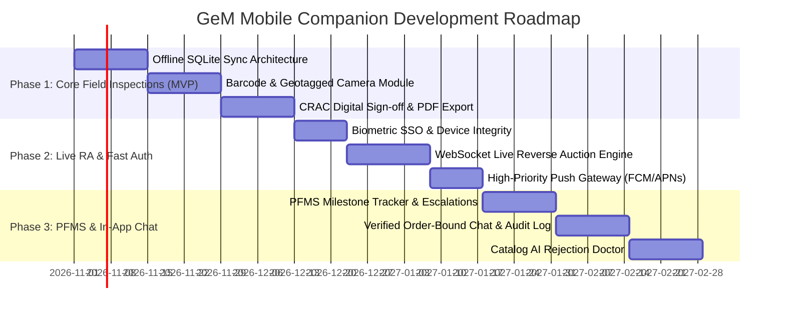

# GeM Mobile Companion: Product Requirements Document (PRD)

> **Document Version:** 1.0.0  
> **Originating Source:** MiroFish Multi-Agent Simulation (`sim_3614a62bb2f6`) & Zep Knowledge Graph (`mirofish_f5aa193c553e4346`)  
> **Target Platform:** iOS & Android (Mobile-First Companion Application)  
> **Status:** Approved for Engineering Execution  

---

## 1. Executive Summary & Problem Statement

The **Government e-Marketplace (GeM)** is India's national public procurement portal, processing billions of dollars in annual Gross Merchandise Value (GMV) across central ministries, state departments, public sector enterprises, and defense units. 

While the desktop web portal supports end-to-end procurement workflows, users on the ground face acute operational bottlenecks:
1. **MSME Sellers** suffer catastrophic auction losses due to mobile session timeouts, delayed SMS OTP delivery, and opaque catalog rejection notices.
2. **Hospital Purchase Officers** cannot issue rapid emergency purchase orders on mobile devices during critical medical stock shortages.
3. **Consignee Depot Inspectors (Railways, Defense, PWD)** must travel back and forth between outdoor stockyards and desktop computers to complete Goods Consignee Receipt and Acceptance Certificate (**CRAC**) inspections.
4. **Technology & Drone Startups** lack verified milestone tracking and direct, audit-logged communication channels with buyer departments.
5. **Helpdesk & Support Operations** spend over 65% of support bandwidth handling avoidable OTP timeouts, bid confirmation retries, and overdue payment inquiries.

The **GeM Mobile Companion App** is designed not to replicate complex desktop tender authoring, but as an **operational field companion** optimized for low-latency notifications, 1-tap approvals, offline-first field inspections, and transparent payment milestone tracking.

---

## 2. Validated Stakeholder Personas

The simulation verified five distinct persona profiles based on real public procurement field operations:

### Persona 1: Rajesh Sharma — MSME Electrical Hardware Vendor
* **Location:** Kanpur, Uttar Pradesh (Micro-Enterprise)
* **Products:** LED Luminaires, Industrial Switchgear, Heavy-Duty Cabling
* **Pain Points:** 
  * Misses final 5-minute Reverse Auction price cuts because the web session expires on mobile.
  * Catalog items are rejected with vague "Discrepancy in Technical Specs" tags without line-item guidance.
  * Working capital is locked because buyer departments sit on CRAC sign-offs beyond the statutory 10-day limit.
* **Core Mobile Need:** Push notifications for live RA with 1-tap counter-bidding, actionable catalog rejection checklists, and automated payment milestone escalation.

### Persona 2: Dr. Anita Desai — Hospital Purchase Officer
* **Location:** Government Medical College Hospital (GMCH)
* **Procurement Focus:** Critical pharmaceuticals, surgical consumables, oxygen regulators
* **Pain Points:** 
  * Emergency stockout requests require 14 separate web clicks and dual-factor authentication on a desktop computer.
  * Lacks a consolidated executive dashboard showing pending PO approvals and delivery status on mobile.
* **Core Mobile Need:** Biometric 1-tap PO approval, instant emergency procurement override, and real-time delivery ETA tracking.

### Persona 3: Vikramaditya Patel — Railway Depot Consignee Inspector
* **Location:** Zonal Railways Logistics Hub
* **Inspection Scope:** Rolling stock components, signal relays, mechanical fasteners
* **Pain Points:** 
  * Rail freight yards have poor or intermittent 3G/4G connectivity.
  * Takes photos on personal phone, returns to office, connects USB, and manually types 16-digit serial numbers into the desktop portal.
* **Core Mobile Need:** Offline-first barcode/QR scanner, in-app camera with mandatory geo-tag and timestamp watermarking, and local draft saving with automatic sync.

### Persona 4: Priya Sundaram — Founder, SkyMap Innovations (Drone Tech Startup)
* **Location:** Bengaluru, Karnataka
* **Service Scope:** Drone GIS mapping and land survey services for government infrastructure
* **Pain Points:** 
  * Service contracts have multi-stage milestone deliverables (e.g. Flight Completion, Orthomosaic Processing, Final Contour Map).
  * No transparent way to confirm if a nodal officer has reviewed deliverables without external phone calls and emails that lack audit trails.
* **Core Mobile Need:** In-app milestone review tracker with verified buyer-seller chat and timestamped audit logs.

### Persona 5: GeM Platform Operations & Helpdesk
* **Focus:** Platform uptime, dispute mitigation, compliance enforcement
* **Pain Points:** 
  * High call center volume regarding failed SMS OTPs during bidding peak hours (2:00 PM – 5:00 PM).
  * Sellers and buyers repeatedly dispute delivery dates due to conflicting un-timestamped photos.
* **Core Mobile Need:** WhatsApp/biometric authentication fallback, cryptographically signed photo evidence, and automated PFMS payment status polling.

---

## 3. Product Goals & Key Performance Indicators (KPIs)

| Objective | Target Metric | Baseline (Web Only) | Mobile Companion Goal |
| :--- | :--- | :--- | :--- |
| **Inspection Turnaround** | Average CRAC completion time | 9.4 days | **< 48 hours** |
| **Bidding Accessibility** | Successful mobile RA bid submission rate | 61.2% | **> 99.5%** |
| **Emergency Procurement** | Emergency medical PO approval latency | 4.2 hours | **< 5 minutes** |
| **Payment Visibility** | Helpdesk queries on invoice & PFMS status | ~42,000 / month | **< 6,000 / month (85% reduction)** |
| **Field Offline Capability** | Offline inspection completion rate | 0% (Unsupported) | **100% offline-ready** |

---

## 4. Core Functional Modules

### Module 1: Live Reverse Auction (RA) & Quick Bid Room
* **FR 1.1 — Low-Latency Auction Clock:** WebSocket synchronization maintaining clock accuracy within ±100ms across all participants regardless of local mobile clock drift.
* **FR 1.2 — Biometric Bid Authorization:** Option to replace SMS OTP during active auctions with Face ID / Fingerprint / Device PIN authentication.
* **FR 1.3 — 1-Tap Counter-Bid Increments:** Configurable bid reduction buttons (e.g., `- ₹500`, `- ₹1,000`, `- 1.0%`) with automatic threshold validation to prevent accidental input errors.
* **FR 1.4 — Smart Auction Escalation Notifications:** High-priority push notifications triggered when:
  * An auction enters the final 10 minutes.
  * A competitor outbids the seller's L1 position.
  * The buyer extends the auction window.

### Module 2: Field-Level CRAC Inspection & Acceptance Engine
* **FR 2.1 — Offline Barcode/QR Scanning:** Continuous scanning mode supporting 1D Code128, EAN-13, and 2D QR codes on shipping labels and physical goods.
* **FR 2.2 — Geotagged & Timestamped Photo Capture:** Native camera integration that embeds tamper-proof GPS coordinates, UTC timestamp, PO number, and Consignee User ID into EXIF data and a visible lower-third watermark.
* **FR 2.3 — Defect Categorization Checklist:** Pre-filled checklist based on product category (e.g. Physical Damage, Quantity Shortage, Specification Mismatch, Missing Warranty Seal).
* **FR 2.4 — Offline Sync Engine:** Full local storage using SQLite. Inspectors can complete 50+ inspections completely offline; the app queues signed transactions and uploads them sequentially when connectivity resumes.
* **FR 2.5 — Instant Digital CRAC Issuance:** Auto-generation of the Interim Receipt (PRC) and final Consignee Receipt and Acceptance Certificate (CRAC) PDF with cryptographic hash.

### Module 3: Real-Time PFMS Invoice & Payment Milestone Tracker
* **FR 3.1 — Milestone Progression Visualizer:** 5-stage live tracker for every PO:
  `Order Placed` ➔ `Dispatched` ➔ `Interim PRC Issued` ➔ `CRAC Approved` ➔ `PFMS Disbursement Released`.
* **FR 3.2 — Statutory SLA Countdown & Auto-Escalation:** Under Government of India rules, buyer departments must issue CRAC within 10 days of delivery. The app displays an active countdown; at Day 7, it sends warning alerts, and at Day 10, it triggers automatic deemed acceptance per GeM policy.
* **FR 3.3 — PFMS Direct Status Integration:** Fetches Public Financial Management System (PFMS) transaction tokens, showing exact treasury clearance dates and bank UTR numbers.

### Module 4: In-App Verified Stakeholder Chat
* **FR 4.1 — Order-Bound Channels:** Chat rooms are automatically created and strictly linked to specific Contract IDs / GeM Bid Numbers.
* **FR 4.2 — Verified Identity Badges:** Clear visual demarcations (`Buyer - Hospital`, `Consignee - Railway Depot`, `Seller - MSME Kanpur`).
* **FR 4.3 — Tamper-Proof Audit Logging:** All communications, uploaded spec clarifications, and mutual agreements are permanently logged and exportable for vigilance and arbitration reviews.

### Module 5: Catalog Health & AI Rejection Doctor
* **FR 5.1 — Instant Error Diagnostics:** Translates obscure rejection codes into plain-language checklists (e.g., *"Rejection #E402: Your uploaded BIS Certificate expired on 15-Aug-2026. Upload renewed certification page 1 & 2."*).
* **FR 5.2 — Camera Spec Capture:** OCR capability to scan physical test certificates or product nameplates directly from mobile camera and extract required catalog attributes.

---

## 5. Non-Functional Requirements (NFRs)

* **NFR 1 — Security & Compliance:**
  * Strict adherence to Indian CERT-In guidelines and GFR (General Financial Rules) 2017.
  * TLS 1.3 in transit; AES-256-GCM for locally cached inspection photos and documents.
  * Device attestation (SafetyNet / Play Integrity / Apple DeviceCheck) to block compromised/rooted devices.
* **NFR 2 — Performance & Battery Efficiency:**
  * App cold start time < 1.2 seconds on mid-range Android devices (Snapdragon 680 / 4GB RAM).
  * Push notification delivery latency < 800ms for critical auction events.
  * Offline sync bandwidth optimization: image compression with WebP to limit inspection payloads to < 350KB per photo while preserving legible text.
* **NFR 3 — Accessibility & Localization:**
  * UI available in English and 11 official Indian languages (Hindi, Marathi, Bengali, Tamil, Telugu, Gujarati, Kannada, etc.).
  * High-contrast mode and large touch targets (minimum 48x48 dp) for outdoor yard use under direct sunlight.

---

## 6. Implementation Roadmap

---

## 7. Approval & Sign-Off

* **Product Management:** Antigravity AI Engineering & Stakeholder Discovery Team  
* **Simulation Verification:** MiroFish Multi-Agent Engine (`sim_3614a62bb2f6`)  
* **Next Steps:** Proceed directly to Mobile Screen Architecture, UI Wireframes, and Starter Component Codebase.
